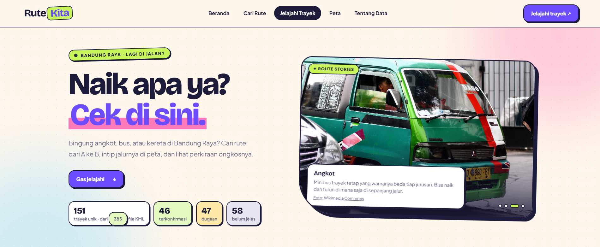
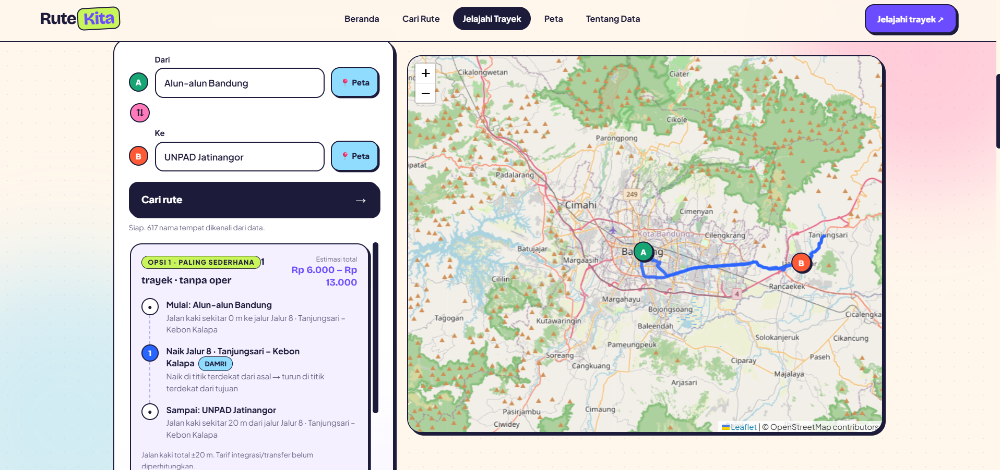
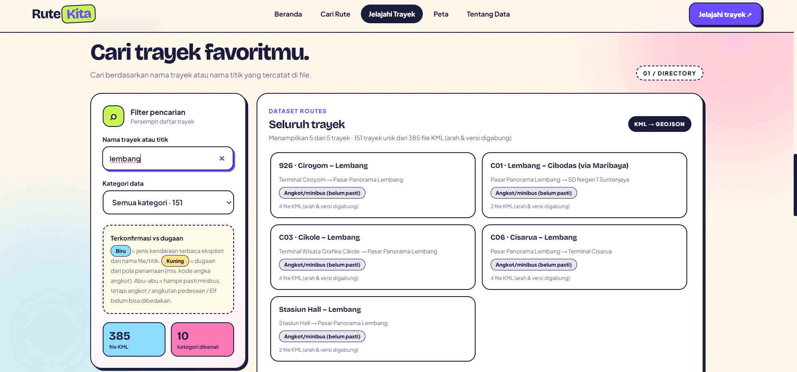
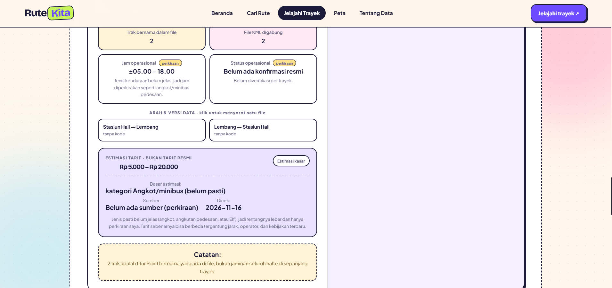
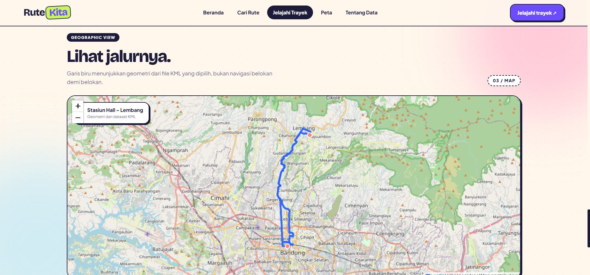
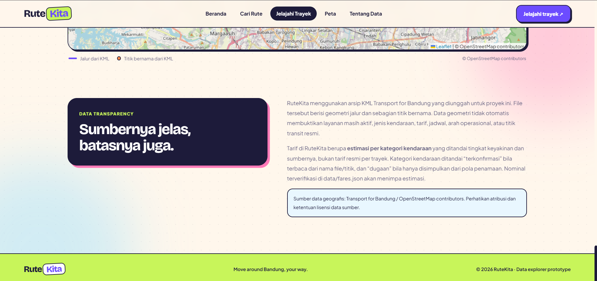

# 🚌 RuteKita — Direktori & Perencana Rute Angkutan Umum Bandung Raya

> **Naik apa ya? Cek di sini.**
> Website untuk mencari rute angkot, bus, dan kereta di Bandung Raya, melihat jalurnya di peta, dan memperkirakan ongkosnya.

Karya untuk **Lomba Programming — ISCOMFEST 2026** (HMPSSI Universitas Mercu Buana Yogyakarta).

| | |
|---|---|
| 🌐 **Demo (live)** | `https://ivankabunga.github.io/PROGRAMMING_Bebas-Weh-Lah_POLBAN/` |
| 📦 **Repository** | `https://github.com/<username>/<nama-repo>` |
| 🎬 **Video demo** | `https://drive.google.com/drive/folders/1BYVZfgS3ImRxV59cjAYBh4DFmzQNSUSz` |
| 👥 **Tim** | `Bebas Weh Lah` — `Politeknik Negeri Bandung` |

---

## 📌 Latar Belakang & Masalah

Angkutan umum di Bandung Raya sangat beragam (angkot, Metro Jabar Trans, Trans Metro Bandung, DAMRI, feeder, Elf, shuttle, Commuter Line), tetapi informasinya tersebar dan sulit dipahami pendatang maupun warga: trayek mana yang lewat tempat tujuan, harus oper di mana, dan berapa ongkosnya.

**RuteKita** menyatukan data geometri 385 file jalur (KML) menjadi **151 trayek unik** yang bisa dicari, dilihat di peta, dan dipakai untuk menyusun perjalanan asal → tujuan.

## ✨ Fitur Utama

- **Cari Rute (asal → tujuan)** — ketik nama tempat (dengan saran otomatis) atau pilih titik lewat peta. RuteKita menyusun urutan trayek, titik oper (maksimal 2 kali), jalan kaki, dan estimasi total tarif.
- **Direktori Trayek** — cari berdasarkan nama trayek/titik dan filter berdasarkan kategori kendaraan.
- **Detail Trayek** — kategori kendaraan, tingkat keyakinan klasifikasi, jam operasional, estimasi tarif beserta sumbernya, dan arah/versi data.
- **Peta Interaktif** — jalur trayek disorot di peta (Leaflet + OpenStreetMap).
- **Transparansi Data** — setiap klasifikasi ditandai *terkonfirmasi / dugaan / belum jelas*; tarif ditandai tingkat keyakinan.
- **Responsif** — tampilan menyesuaikan layar ponsel hingga desktop.

## 🖼️ Tangkapan Layar









## 🛠️ Teknologi

| Bagian | Teknologi |
|---|---|
| Frontend | HTML5, CSS3, JavaScript (vanilla, tanpa framework & tanpa build step) |
| Peta | [Leaflet](https://leafletjs.com/) 1.9.4 + ubin peta OpenStreetMap |
| Font | Bricolage Grotesque & Plus Jakarta Sans (Google Fonts) |
| Data | JSON statis (hasil olahan KML) |
| Skrip data | Python 3 (hanya *standard library*) |

Tidak ada backend dan database: seluruh data dimuat langsung di browser lewat `fetch()`.

## 📁 Struktur Repository

```
rutekita/
├── index.html                  # Halaman utama (single page)
├── css/
│   └── style.css               # Tema pastel-sticker
├── js/
│   ├── app.js                  # Direktori trayek, filter, detail, peta
│   ├── planner.js              # Fitur Cari Rute (asal → tujuan)
│   └── hero.js                 # Galeri kendaraan di bagian hero
├── data/
│   ├── route-catalog.json      # Katalog 151 trayek (kategori, titik, keyakinan)
│   ├── routes-geo.json         # Geometri jalur (GeoJSON dari KML)
│   ├── planner-index.json      # Indeks untuk pencarian rute (hasil build)
│   ├── fare-estimates.json     # Estimasi tarif per kategori + sumber
│   ├── fares.json              # Tarif terverifikasi per trayek (menimpa estimasi)
│   ├── schedules.json          # Jam operasional per kategori
│   └── DATASET_NOTES.md        # Aturan klasifikasi data
├── img/
│   └── README.txt              # Cara menambah foto kendaraan sendiri
├── tools/
│   └── build_planner_index.py  # Membangun ulang data/planner-index.json
├── docs/
│   └── screenshots/            # Tangkapan layar untuk README/proposal
├── CHANGELOG.md                # Riwayat versi
├── LICENSE
└── README.md
```

## 🚀 Cara Menjalankan

### Cara paling mudah
Akses langsung di browser : https://ivankabunga.github.io/PROGRAMMING_Bebas-Weh-Lah_POLBAN/

### Cara Lain : Prasyarat
- Browser modern (Chrome, Edge, Firefox, Safari — versi terbaru)
- Salah satu: **VS Code + Live Server**, **Python 3**, atau **Node.js**

### 1. Ambil source code

```bash
git clone https://github.com/IvankaBunga/PROGRAMMING_Bebas-Weh-Lah_POLBAN.git
cd PROGRAMMING_Bebas-Weh-Lah_POLBAN.git
```
*(Atau unduh ZIP dari GitHub/Google Drive, lalu ekstrak.)*

### 2. Jalankan — pilih salah satu

**Opsi A — VS Code + Live Server (paling mudah)**
1. Buka folder proyek di VS Code.
2. Pasang ekstensi **Live Server** (Ritwick Dey).
3. Klik kanan `index.html` → **Open with Live Server**.

**Opsi B — Python**
```bash
python3 -m http.server 8000
```
Buka **http://localhost:8000** di browser. *(Windows: gunakan `python` atau `py`.)*

**Opsi C — Node.js**
```bash
npx serve .
```
Buka alamat yang tampil di terminal (biasanya http://localhost:3000).

### 3. Coba fitur utama
1. Di bagian **"Mau ke mana nih?"**, isi *Dari* dan *Ke*, mis. **Terminal Ciparay → Pasar Panorama Lembang**, lalu klik **Cari rute**. Alternatif: klik **📍 Peta** lalu klik lokasi di peta.
2. Di **"Cari trayek favoritmu"**, ketik nama trayek/tempat atau pilih kategori kendaraan.
3. Klik salah satu kartu trayek untuk melihat detail dan jalurnya di peta.

## ☁️ Deploy ke GitHub Pages (opsional, gratis)

1. Push proyek ke repository GitHub (**Public**).
2. Buka **Settings → Pages**.
3. Pada *Build and deployment*, pilih **Deploy from a branch**, branch `main`, folder `/ (root)`, lalu **Save**.
4. Tunggu 1–2 menit;

Karena seluruh path bersifat relatif, website langsung berjalan tanpa konfigurasi tambahan. Alternatif hosting gratis: Netlify, Vercel, atau Cloudflare Pages (cukup *drag & drop* folder).

## 🔄 Memperbarui Data

| Tujuan | Langkah |
|---|---|
| Data jalur/KML berubah | Perbarui `data/route-catalog.json` & `data/routes-geo.json`, lalu jalankan `python3 tools/build_planner_index.py` dari folder root |
| Ubah estimasi tarif | Edit `min`, `max`, `confidence`, `sources` pada kategori terkait di `data/fare-estimates.json` |
| Isi tarif pasti satu trayek | Isi `data/fares.json` (kunci = id trayek); nilai ini menimpa estimasi |
| Perbarui jam operasional | Edit `data/schedules.json` |
| Tambah foto kendaraan | Taruh `mjt.jpg`, `damri.jpg`, dst. di `img/` (lihat `img/README.txt`) |

## ⚠️ Batasan Penting

- **Estimasi tarif bukan tarif resmi per trayek.** Tingkat *kasar* berarti sumbernya lemah. Riset tarif dilakukan 16 November 2026 dan dapat berubah.
- Label **"dugaan"** hanyalah inferensi dari pola penamaan file, bukan fakta. Verifikasi ke Dishub/operator sebelum dipakai untuk perjalanan nyata.
- Geometri KML **tidak membuktikan** layanan masih aktif.
- Rute disusun dari **kedekatan jalur** di KML (bukan jadwal/arah resmi) sehingga hasilnya berupa saran, bukan navigasi belokan demi belokan.

Aturan klasifikasi selengkapnya ada di [`data/DATASET_NOTES.md`](data/DATASET_NOTES.md).

## 📚 Sumber Data & Atribusi

- **Data jalur:** Transport for Bandung / © OpenStreetMap contributors — tersedia di bawah [Open Database License (ODbL) 1.0](https://opendatacommons.org/licenses/odbl/1-0/). Data turunan di folder `data/` tetap mengikuti ketentuan ODbL (atribusi + *share-alike*).
- **Peta dasar:** © [OpenStreetMap contributors](https://www.openstreetmap.org/copyright).
- **Library:** [Leaflet](https://leafletjs.com/) (BSD-2-Clause).
- **Font:** [Bricolage Grotesque](https://fonts.google.com/specimen/Bricolage+Grotesque) dan [Plus Jakarta Sans](https://fonts.google.com/specimen/Plus+Jakarta+Sans) (SIL Open Font License).
- **Foto hero:** [Wikimedia Commons](https://commons.wikimedia.org/) — kredit ditampilkan langsung di bawah foto pada website; foto lain (bila ada) adalah koleksi tim di `img/`.
- **Sumber tarif & jadwal:** tercantum per kategori di `data/fare-estimates.json` dan `data/schedules.json`.

Seluruh kode aplikasi (HTML, CSS, JavaScript, skrip Python) ditulis sendiri oleh tim.

## 📄 Lisensi

Kode: [MIT License](LICENSE). Data: ODbL 1.0 (lihat bagian atribusi di atas).

## 👥 Tim

| Nama | Peran |
|---|---|
| `<Nama Ketua>` | Ketua / `<peran>` |
| `<Nama Anggota>` | `<peran>` |

Dibuat untuk **ISCOMFEST 2026 — Lomba Programming**.
